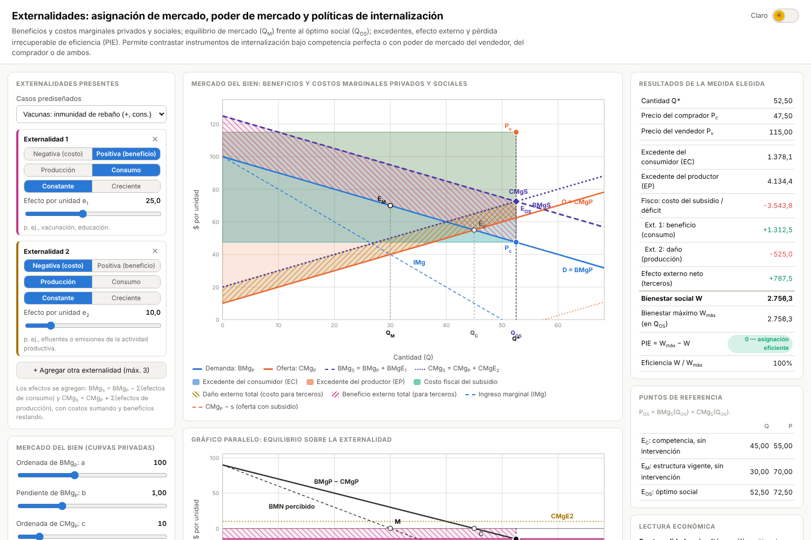

# Simulador: Externalidades, poder de mercado e internalización

**[▶ Abrir el simulador](https://fcontiggiani.github.io/externalidades/externalidades.html)**

Simulador interactivo para la **Clase 26 — Fallas de mercado: externalidades** (Microeconomía, Contador Público, UNRN).
Es un único archivo (`externalidades.html`) con HTML, JavaScript y SVG. No tiene dependencias externas y funciona sin conexión y dentro de Moodle.

---

## 1. Contenido pedagógico

### 1.1 Externalidades
- **Tipología completa.** Cada externalidad puede ser:
  - positiva o negativa;
  - de consumo o de producción;
  - de efecto marginal constante (EMg = e) o creciente (EMg = g·Q).
- **Hasta tres externalidades simultáneas.** Se agregan con signo en el efecto externo marginal neto:

  X(Q) = Σₖ sₖ·EMgₖ(Q),  con sₖ = +1 para un costo y −1 para un beneficio.

  - Los efectos de consumo desplazan la curva de beneficio social: BMgS = BMgP − Σ(costos de consumo) + Σ(beneficios de consumo).
  - Los efectos de producción desplazan la curva de costo social: CMgS = CMgP + Σ(costos de producción) − Σ(beneficios de producción).
  - Si hay efectos en ambos lados, se desplazan las dos curvas sociales.
- **Casos prediseñados:**

| Caso | Externalidades |
|---|---|
| Una externalidad (estándar) | Negativa de producción, constante |
| Transporte automotor | Emisiones (−, producción) + congestión (−, consumo, creciente) |
| Vacunas | Inmunidad de rebaño (+, consumo) + residuos industriales (−, producción) |
| Fruticultura del Alto Valle | Polinización (+, producción) + deriva de agroquímicos (−, producción, creciente) |
| Compensación exacta | Daño de producción = beneficio de consumo (Q_C = Q_OS, pero P_OS ≠ P_C) |

- **Mensaje central con varias externalidades.**
  - La **eficiencia** depende solo del efecto marginal **neto**, que es el que define la cuña correctora.
  - La **distribución** depende de cada componente: los terceros dañados no quedan compensados por lo que reciben los beneficiados.

### 1.2 Asignación de mercado y óptimo social
- **Curvas** con la notación de la cátedra: BMgP, CMgP, BMgS y CMgS. CMgE y BMgE denotan el costo y el beneficio marginal externo.
- **Puntos de referencia:**
  - E_C: equilibrio competitivo sin intervención.
  - E_M: equilibrio de la estructura de mercado vigente.
  - E_OS: óptimo social (BMgS = CMgS).
  - E*: resultado de la medida elegida.
- **Gráfico paralelo de la externalidad.** Muestra:
  - el beneficio marginal neto privado BMN = BMgP − CMgP;
  - el BMN percibido con poder de mercado;
  - el efecto externo marginal neto X(Q) y cada uno de sus componentes;
  - la cuña del instrumento.

  El óptimo social está donde BMN = X(Q).

### 1.3 Poder de mercado
| Estructura | Condición de equilibrio | Cantidad (con cuña t) |
|---|---|---|
| Competencia perfecta | BMgP = CMgP + t | (a − c − t)/(b + d) |
| Monopolio (vendedor) | IMg = CMgP + t | (a − c − t)/(2b + d) |
| Monopsonio (comprador) | BMgP = GMg + t | (a − c − t)/(b + 2d) |
| Monopolio bilateral | Lado corto: mín{Q_monopolio, Q_monopsonio} | El precio se reparte con β entre CMgP(Q) y BMgP(Q) |

La lectura automática indica cuándo el poder de mercado **compensa** una externalidad neta negativa y cuándo **agrava** una positiva.

### 1.4 Bienestar
- **Cuentas:**
  - excedente del consumidor (EC) y del productor (EP);
  - resultado fiscal y rentas (de cuotas o permisos);
  - efecto externo total, desglosado por externalidad cuando hay varias.
- **Indicadores:** bienestar social W, bienestar máximo W_máx, pérdida irrecuperable de eficiencia (PIE = W_máx − W) y % de eficiencia (W / W_máx).
- **Sombreados que se pueden mostrar u ocultar:** excedentes, PIE y efecto externo. Los costos externos llevan rayado ocre y los beneficios externos, rayado magenta.

### 1.5 Medidas de internalización
Todas se comparan en una **tabla de contraste** con Q, P, cuña, fisco, W, PIE y % de eficiencia. Un clic en una fila selecciona esa medida.

| Medida | Regla implementada |
|---|---|
| Sin intervención | Equilibrio de la estructura vigente |
| Impuesto/subsidio pigouviano | t = X(Q_OS) (impuesto si es positivo, subsidio si es negativo). Es el primer mejor solo en competencia |
| Impuesto/subsidio de 2.º mejor | t* tal que el equilibrio de la estructura vigente alcance Q_OS. Puede invertir su signo (Buchanan, 1969) |
| Cuña manual | t libre en [−60, 60] |
| Orden y control | Tope Q̄ = Q_OS (efecto neto negativo) o mínimo obligatorio (efecto neto positivo) |
| Permisos transferibles | Tope = Q_OS. El precio del permiso es la cuña de equilibrio; la renta va al fisco (subasta) o al lado generador (asignación gratuita) |
| Negociación de Coase | El generador iguala su BMN percibido con X(Q). Los derechos (de los afectados o de los generadores) definen solo quién paga a quién |
| Provisión pública directa | El Estado produce Q_OS y lo vende a BMgP(Q_OS) |

### 1.6 Apoyos a la lectura
- **Panel de fórmulas:** condiciones de primer orden, solución de Q_OS = (a − c − X₀)/(b + d + X₁) con la verificación de la condición de segundo orden (b + d + X₁ > 0), y la regla del instrumento elegido.
- **Lectura económica automática:**
  - sobreasignación o subasignación;
  - interacción entre el poder de mercado y la externalidad;
  - eficiencia frente a distribución;
  - limitaciones del instrumento elegido.
- **Interruptor de tema claro/oscuro** en el encabezado.

---

## 2. Controles

| Control | Función |
|---|---|
| Casos prediseñados | Carga una combinación típica de una o dos externalidades |
| Tarjetas de externalidad (+ Agregar / ✕) | Hasta 3 externalidades, cada una con impacto, origen, forma y magnitud (e o g) |
| a, b | Demanda privada BMgP(Q) = a − bQ |
| c, d | Oferta privada CMgP(Q) = c + dQ |
| Estructura de mercado | Competencia, monopolio, monopsonio o monopolio bilateral |
| β | Poder de negociación del vendedor (solo en monopolio bilateral) |
| Medida de internalización | Instrumento a analizar (también se elige con un clic en la tabla comparativa) |
| Cuña t | Impuesto (> 0) o subsidio (< 0) por unidad (solo con cuña manual) |
| Derechos de propiedad | De los afectados o de los generadores (Coase, efecto neto negativo) |
| Subasta de permisos | Renta fiscal (subasta) o del lado generador (asignación gratuita) |
| Visualización | Mostrar u ocultar excedentes, PIE, efecto externo, IMg/GMg y puntos de referencia |
| Interruptor de tema | Tema claro u oscuro |

---

## 3. Sugerencias de uso en clase

1. **Las cuatro externalidades básicas.** Con el caso estándar, recorrer las combinaciones de signo y origen (las cuatro de la clase) y verificar la tabla de la Clase 26: Q_OS frente a Q_M y P_OS frente a P_M.
2. **Pigou en competencia.** Comparar el impuesto pigouviano con la regulación de cantidad y con los permisos: los tres alcanzan el 100 % de eficiencia, pero con distinta distribución entre fisco, productores y consumidores.
3. **Buchanan.** Pasar a monopolio con una externalidad negativa moderada (e ≈ 10). El impuesto pigouviano reduce el bienestar y la cuña de 2.º mejor resulta un subsidio.
4. **Coase y poder de mercado.** Con poder de mercado, la negociación no alcanza el óptimo: corrige la externalidad, pero no la restricción de cantidad.
5. **Varias externalidades.** Con el caso «Compensación exacta», el mercado competitivo es eficiente, pero hay terceros dañados y terceros beneficiados. Sirve para discutir eficiencia frente a equidad. Con «Fruticultura», el efecto neto cambia de signo a lo largo de Q.

---

## 4. Supuestos del modelo

- **Forma funcional.** Las curvas privadas y los efectos externos son lineales.
- **Bienestar.** W = ∫₀^Q [BMgS(q) − CMgS(q)] dq. Los impuestos, los subsidios, las rentas y los pagos de Coase son transferencias y no alteran W.
- **Cantidad regulada.** El precio lo fija el lado con poder de mercado. En competencia, lo fija el lado generador dominante, que retiene la renta de escasez.
- **Coase.** El generador negocia con los afectados, pero no con la contraparte del mercado. Por eso internaliza la externalidad, pero no el poder de mercado.
  - Transferencia mínima con derechos de los generadores: el beneficio neto privado al que renuncian, ½·m·(Q₀ − Q)², donde m es la pendiente del BMN percibido.
  - Transferencia mínima con derechos de los afectados: el daño causado.
  - Con varias externalidades se supone que todos los terceros negocian coordinadamente.
- **Óptimo interior.** Si la pendiente neta X₁ ≤ −(b + d), no hay óptimo interior finito. En ese caso se reescalan las pendientes de los beneficios externos crecientes hasta X₁ = −0,9·(b + d), y el simulador lo advierte.
- **Datos.** Los valores numéricos son ilustrativos.

---

## 5. Requisitos técnicos

- Navegador moderno (Chrome, Firefox, Edge o Safari) con JavaScript habilitado.
- No usa CDN ni bibliotecas externas: el gráfico es SVG nativo.
- La preferencia de tema se guarda en `localStorage` con protección `try/catch`, para tolerar las restricciones de los iframes de Moodle.
- Diseño adaptable desde 800 px de ancho.

---

## 6. Validación

- **Modelo.** Se validó en Node.js con más de 166.000 verificaciones aleatorias, que cubren las cuatro estructuras de mercado, los ocho instrumentos y combinaciones de 1 a 3 externalidades. Se verifica:
  - la identidad de bienestar W = ∫(BMgS − CMgS) y la cota W ≤ W_máx;
  - BMgS = CMgS en Q_OS;
  - que la suma de los componentes del efecto externo sea igual al efecto neto;
  - que el 2.º mejor alcance siempre Q_OS, y que el pigouviano y Coase lo alcancen en competencia;
  - las condiciones IMg − t = CMgP y BMgP = GMg + t;
  - el resultado de Buchanan (1969) y el caso de compensación exacta.
- **Interfaz.** Se probó con Playwright en tema claro y oscuro, en 1500 px y 820 px, sin errores de consola.

## Referencias

- Pindyck, R. y Rubinfeld, D. (2009). *Microeconomía*. Pearson, cap. 18.
- Varian, H. *Microeconomía intermedia*, cap. 34 (externalidades).
- Acemoglu, D., Laibson, D. y List, J. (2017). *Economía*. Antoni Bosch, caps. 9 y 16.
- Buchanan, J. M. (1969). External diseconomies, corrective taxes, and market structure. *American Economic Review*, 59(1), 174–177.
- Coase, R. H. (1960). The problem of social cost. *Journal of Law and Economics*, 3, 1–44.
